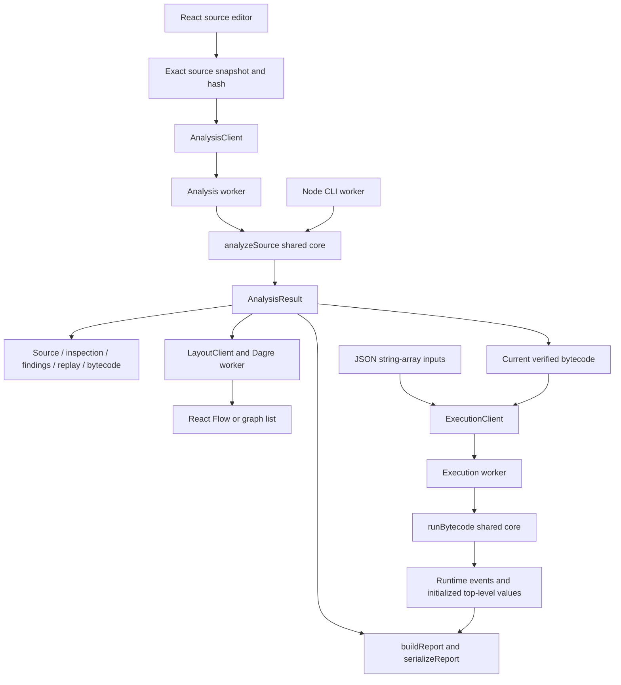

# FlowGuard implementation and architecture guide

This guide maps the implementation inspected on **11 October 2026** to its files, algorithms, data structures, and application behavior. Paths are relative to the repository root. Read [demo_guide.md](demo_guide.md) for presentation steps and [pcd_guide.md](pcd_guide.md) for the concepts behind these modules.

## 1. System structure

FlowGuard is an npm-workspace TypeScript project with three application packages:

| Location | Responsibility |
|---|---|
| `packages/core/` | Portable synchronous compiler, input-flow analyzer, bytecode generator, verifier, VM, contracts, and report serialization. |
| `apps/web/` | React workspace; browser file/download adapters; separate analysis, graph-layout, and execution workers. |
| `packages/cli/` | Node command-line adapter for the same core, including bounded file I/O and responsive cancellation. |
| `examples/` | Small synthetic `.fg` programs and their UI catalog. |
| `fixtures/` | Valid/invalid compiler cases and taint/runtime expectations used by the retained tests. |
| Root guides | Presentation walkthroughs, implementation reference, and compiler-concept explanations. |
| `test-results/` | Disposable generated test output; ignored by Git and excluded from a submission ZIP. |

There is no application backend, account system, database, or source-history store. Browser drafts stay in memory. Node provides local CLI I/O; Vite serves browser assets. SQL/shell operations produce simulated events.

### Libraries and their actual responsibilities

Versions below come from the current package manifests, not a lookup of latest releases:

| Library/tool | Project version | Used for |
|---|---|---|
| TypeScript | 7.0.2 | Building and typechecking the implementation. |
| React / React DOM | 19.3.0 | UI components and rendering. |
| Monaco Editor | 0.57.0 | Source editing, highlighting, markers, and editor navigation. |
| React Flow (`@xyflow/react`) | 12.12.0 | Displaying the compiler's nodes and semantic edges. |
| Dagre | 3.1.1 | Calculating graph node positions. |
| Zod | 4.6.5 | Validating strict versioned data contracts at boundaries. |
| Vite | 8.3.2 | Development server, bundled browser workers, production build and preview. |
| Vitest / Playwright | 5.0.3 / 1.63.0 | Unit/CLI checks and real Chromium workflow checks. |

The project implements its own lexer, parser, semantic checker, lowering, taint analysis, code generation, bytecode verifier, and VM. Monaco's token coloring does not replace compiler lexical analysis; Dagre does not calculate program control flow.

## 2. End-to-end data flow



The core pipeline is:

```text
request validation → lex → parse → semantic → lower
→ taint → findings/provenance → codegen → verify
```

`Run` is a separate request. Analyze never executes the source program. In the CLI, `--run` requests analysis first and then execution only if analysis completed.

## 3. Contracts and identifiers

### Main data structures

Defined by [contracts.ts](packages/core/src/contracts.ts), with TypeScript aliases/interfaces in [model.ts](packages/core/src/model.ts):

| Structure | Contents and purpose |
|---|---|
| `SourceSnapshot` | Exact source, display filename, revision, SHA-256, and `snapshot-${revision}-${sha256}` identity. |
| `SourceSpan` | Start/end UTF-16 offsets and one-based start/end line/column. End offsets are exclusive. |
| `Token` | `tok-N`, token kind, original lexeme, source span, and optional decoded typed literal. |
| `Program` / AST nodes | `ast-N`, node kind, spans, and declaration/expression/control-flow structure. |
| `SemanticModel` | Symbols, scopes, expression types, resolved uses, input-source identities, and diagnostics. |
| `LoweredProgram` | Typed user/temporary slots, instructions, edges, entry/exit IDs, and source map. |
| `TaintResult` | Each IR node's incoming/outgoing source sets, reachability, pop/update counts, and reached-node IDs. |
| `Finding` | Rule, sink IR/AST identity, argument index 0, source span, contributing source IDs, and explanation references. |
| `ReplayTrace` | State-change events, checkpoints, truncation flag, and omitted-update count. |
| `BytecodeArtifact` | Version, snapshot/hash, constants, typed slots, input-source table, instructions, source map, maximum verified stack, and top-level symbol IDs. |
| `AnalysisResult` | Status, sequential completed stages, available artifacts, diagnostics, statistics, limits, and limitations. |
| `ExecutionResult` | Runtime status, diagnostics, events, consumed inputs, instruction count, elapsed time, and final initialized top-level values. |
| `Report` | Analysis plus optional execution belonging to the same snapshot/revision. |

IDs have distinct meanings: `sym-N` is a declared variable, `slot-N` is storage, `src-N` is a syntactic input occurrence, and `ir-N` is a lowered instruction/CFG node. A bytecode **PC** is an instruction index, not an IR node ID. One IR instruction usually generates several bytecode instructions.

`boundary(schema)` rejects cyclic/non-serializable payloads and explicit `undefined` values, then validates the schema. Strict objects reject unknown fields. Versions and fixed limits are part of the contracts. AST validation uses iterative traversal to support deep flat expressions without recursive schema traversal.

The snapshot hash correlates artifacts with exact source content. Browser/CLI adapters compute it; the browser analysis worker recomputes it before entering the core. A hash is an identity check, not a security certificate for the analyzed program.

## 4. Compiler frontend and lowering

| File | Entry points / exact responsibility |
|---|---|
| [analyze.ts](packages/core/src/analyze.ts) | `analyzeSource`: request validation, stage coordination, progress, statistics, artifact gating, and failure/status conversion. |
| [lexer.ts](packages/core/src/lexer.ts) | `lex`: handwritten character scanning, keyword/operator tables, comments, integer/string decoding, token IDs and spans, EOF. |
| [parser.ts](packages/core/src/parser.ts) | `Parser`, `parse`: recursive-descent statement parsing, precedence-climbing expressions, blocks, unary/primary forms, AST construction and IDs. |
| [semantic.ts](packages/core/src/semantic.ts) | `SemanticChecker`, `checkSemantics`: lexical scope stack, name resolution, symbol/slot identities, exact types, built-in arguments, input-source allocation, diagnostics. |
| [ast.ts](packages/core/src/ast.ts) | `children`, `preorder`: iterative AST traversal used for identities, source discovery, and validation. |
| [lower.ts](packages/core/src/lower.ts) | `Lowerer`, `lowerProgram`: AST/semantic model to typed instructions, temporary slots, labels, branches, jumps, source maps, and lexical visibility. |
| [graph.ts](packages/core/src/graph.ts) | `deriveEdges`, `adjacency`, `validateLoweredProgram`: build/validate semantic CFG edges, predecessors/successors, references and instruction typing. |
| [source.ts](packages/core/src/source.ts) | UTF-8 byte counting/decoding, exact line index, binary-search position lookup, span creation/validation. |

### Lexer and parser details

The lexer recognizes ASCII identifiers, reserved words, decimal integer literals, supported string escapes, whitespace, and line/block comments. It checks two-character operators before single-character operators. It preserves original offsets and skips a leading BOM for token recognition without removing it from the snapshot. Invalid characters, unterminated strings/comments, unsupported escapes, and out-of-range integer literals produce source failures.

The parser's statement cases are declarations, assignments, blocks, `if`, `while`, and effect calls. `expression(min)` assigns precedence levels: OR, AND, equality, relational, addition/subtraction, multiplication/division/remainder. Parsing the right side at `rank + 1` implements left associativity. Unary expressions and grouped/input expressions are handled separately. IDs are assigned in AST preorder after successful parsing. Lexer/parser stop on the first source error; a failed parse does not publish a partial AST.

### Semantic details

Scopes are a stack of frames containing a `Scope` and `Map<string, Symbol>`. Lookup searches the current frame outward. A declaration's initializer is checked **before** its name enters scope. Same-scope duplicates and visible-name shadowing are errors; sibling blocks can reuse a name with different identities.

Expression checking uses an explicit postorder task stack. `expressionTypes` maps AST IDs to types; `resolvedUses` maps declaration/assignment/variable AST IDs to symbols. Types are exactly `string`, signed int32, or `bool`, with no automatic conversion. `+` permits int/int or string/string, conditions require bool, and comparisons/arithmetic have their specified operand types.

`input` takes a string prompt and returns string. `print` accepts one scalar; `sql_query`/`shell` accept one string; `sql_bind` accepts a string template and one scalar value. A literal binding template must have exactly one decoded `?`. A nonliteral template produces the nonblocking `TEMPLATE_UNVERIFIED` notice. Counting `?` characters does not parse SQL.

Each input AST occurrence gets `src-N`, sorted by source start offset. An occurrence inside a loop keeps the same identity across runtime iterations. Semantic checking retains at most 100 ordinary diagnostics, followed by a cap diagnostic if necessary.

### Lowering details

User slots are allocated in symbol order; temporary slots are appended while lowering expressions. Instructions are `const`, `copy`, `unary`, `binary`, `input`, `effect`, `branch`, `jump`, and `halt`. Expressions evaluate left-to-right. Declarations and assignments end with copies into user slots.

`if` introduces true/false alternatives and a join; `while` introduces a test, body, backedge, and exit. `&&`/`||` become branches that either evaluate the right operand or write a fixed boolean, then join. There is no eager AND/OR bytecode instruction. Labels are resolved to IR identities after emission, and one final HALT is appended.

Each instruction keeps its owner AST ID, source span, and visible symbol IDs. Block exits restore lexical visibility. `validateLoweredProgram` checks IDs, types, source mapping, targets, edges, and entry/exit before the graph is used by later passes. Nodes represent individual lowered instructions, not basic blocks containing many instructions.

## 5. Input-flow analysis, findings, explanations, and replay

| File | Responsibility |
|---|---|
| [taint.ts](packages/core/src/taint.ts) | `unionSources`, `solveTaint`: finite source-set representation, forward FIFO worklist, joins/transfers, convergence, storage/work limits, optional replay recording. |
| [findings.ts](packages/core/src/findings.ts) | `collectFindings`: inspect converged incoming state at sensitive effect argument zero and create deterministic findings. |
| [provenance.ts](packages/core/src/provenance.ts) | `buildProvenance`: backward traversal of supporting dependency facts, shared fact IDs, deduplication, cycles, and explanation limits. |
| [replay.ts](packages/core/src/replay.ts) | `ReplayRecorder`, `applyReplayEvent`, `reconstructReplay`: changed output states, undo/apply, checkpoints, and bounded reconstruction. |

### Solver algorithm

Internally, each reached state contains an immutable source-index set per slot. Source sets are sorted arrays of numeric IDs. `unionSources` merges two arrays without duplicates. Serialized states expose `src-N` strings.

The entry starts scheduled in a membership-deduplicated FIFO queue. For each popped node:

1. Union the outputs of reached predecessors to produce the incoming slot states.
2. Apply the instruction transfer rule.
3. Retain/check incoming state and source-membership storage.
4. If outgoing state or reachability changed, record a replay update and schedule successors in instruction order.
5. Continue until no scheduled work remains, or a budget/cancellation fails the operation.

| Instruction | Destination source set |
|---|---|
| Constant | Empty: fixed data has no tracked input contribution. |
| Input | Singleton containing this syntactic input occurrence. |
| Copy / unary | Copy the source operand's set. |
| Binary | Union the two operand sets. |
| Branch / jump / effect / halt | Preserve slot state; no destination update. |

Assignments replace a destination's prior set on that path. At control-flow joins, alternatives union. Both structural branches are retained; the solver does not evaluate branch feasibility. Condition taint is not transferred into variables merely because it controls a branch. This is explicit **may-flow** analysis.

Findings check only reachable effect instructions, exclude `print`, and inspect argument 0. `shell` uses `SHELL_COMMAND_TEXT`; `sql_query` and tainted `sql_bind` templates use `SQL_QUERY_TEXT`. A bound value alone does not trigger query-text taint. Each finding includes all contributing sources, sorted by source location/rule/argument for presentation.

### Provenance and replay boundaries

Provenance starts from each sink's contributing source and follows final-state dependencies backward. Its explicit stack, active/expanded sets, cache, and cycle facts prevent recursive or repeated-path expansion. Global facts are capped at 20,000 and visible facts per finding at 200. Truncation sets `explanationComplete = false`; contributing source IDs remain available.

Replay stores changed output/reachability deltas, an initial checkpoint at index -1, and checkpoints every 100 retained updates. Immutable states permit sharing unchanged data. Recording stops at 10,000 events or 8 MiB and counts omitted updates; the solver continues to compute final states. Reconstruction starts at the nearest preceding checkpoint. Replay is solver history, not concrete VM execution.

## 6. Bytecode generation, verification, and execution

| File | Responsibility |
|---|---|
| [codegen.ts](packages/core/src/codegen.ts) | `generateBytecode`: typed stack instructions, constant deduplication, IR-to-PC starts, jump patching, source table/maps, top-level symbol metadata. `disassembleBytecode`: readable instruction rows. |
| [verify.ts](packages/core/src/verify.ts) | `verifyBytecode`: schema/identity/reference checks, reachable stack-type propagation, definite initialization, verified maximum stack. |
| [vm.ts](packages/core/src/vm.ts) | `runBytecode`: execution-request validation, reverification, scalar storage/stack, PC dispatch, runtime input/events/arithmetic, limits, final-value projection. |

### Code generation

Every IR instruction generates a balanced stack sequence, leaving an empty stack at its boundary. Constants deduplicate by typed value in first-use order. Examples:

```text
IR constant: PUSH_CONST → STORE destination
IR copy:     LOAD source → STORE destination
IR addition: LOAD left → LOAD right → ADD_INT → STORE destination
IR query:    LOAD query slot → SQL_QUERY
```

String addition uses `CONCAT_STRING`. Branches emit a condition load, `JUMP_IF_FALSE`, and an unconditional jump. Generation records each IR node's starting PC, then patches jump operands to those starts. Every emitted PC carries an IR ID, AST ID, and original span.

`topLevelSymbolIds` comes from final HALT visibility, sorted by symbol order. It distinguishes final user-visible variables from block locals and temporary slots.

### Verifier: two separate data-flow checks

First, validate artifact/version/operand arity, slot/source references, jumps, metadata, source-map coverage, and snapshot/hash identity. Build bytecode predecessors/successors and structural reachability.

**Stack typing:** begin with an empty stack at PC 0. Simulate each opcode's type effects, reject underflow/mismatches, require identical stack types at joins, and track maximum depth. HALT requires an empty stack.

**Definite initialization:** use bitsets for initialized slots. Entry includes an external empty initialized set; other reached PCs start with the full slot universe. At a merge, intersect reached predecessor outputs; STORE adds a slot. Iterate downward to a greatest fixed point, then reject a LOAD unless its slot is initialized on every represented incoming path. This is a **must** analysis, distinct from the taint solver's union-based **may** analysis.

Each verifier worklist pass is capped at 200,000 visits and shares the active BudgetGuard deadline. During compilation that is the analysis deadline; VM reverification uses the execution guard.

### VM details

`runBytecode` validates the input array and execution envelope, then calls the verifier again. It holds typed scalar slots, a stack, and a PC. Its opcode switch performs loads/stores, arithmetic, concatenation, comparisons, jumps, inputs/effects, and HALT.

Arithmetic uses BigInt intermediates, then checks signed 32-bit bounds. Division truncates toward zero; remainder follows the dividend. Missing input, division/remainder by zero, and overflow return `runtime-error`. Inputs are consumed in execution encounter order; an input skipped by short circuit consumes no value.

Events contain index, PC, source span, and operation payload. `print` records a typed value. SQL/shell events are explicitly `simulated: true`. There is no source `eval`, database connection, or process spawning in the VM. Only HALT means successful completion.

After verified execution, project initialized values for `topLevelSymbolIds`. Block locals, temporaries, and unreached/uninitialized declarations are omitted. Core-reported failures can retain earlier events and initialized top-level values. Browser worker termination cannot recover local execution state.

## 7. Browser request lifecycle and state management

| File | Responsibility |
|---|---|
| [main.tsx](apps/web/src/main.tsx) | Creates the React root, renders App in StrictMode, imports styles. |
| [App.tsx](apps/web/src/App.tsx) | Composes workspace/navigation, current-result counts, actions, graph, inspectors, findings, replay, exports, bytecode, inputs, runtime, and replacement dialog. |
| [useWorkspace.ts](apps/web/src/workspace/useWorkspace.ts) | Owns reducer and clients; captures snapshots; starts/cancels work; coordinates file/save/export; handles edit retirement, shortcuts, playback, and cleanup. |
| [types.ts](apps/web/src/workspace/types.ts) | Browser workspace state/action types, including draft/stale statuses beyond core statuses. |
| [reducer.ts](apps/web/src/workspace/reducer.ts) | Pure action transitions; revision/request guards; edit invalidation; selection linking; replay mode; input validation; replacement/download notices. |
| [selectors.ts](apps/web/src/workspace/selectors.ts) | `hasCurrentAnalysis`, `canAnalyze`, `canRun`, `canUseCurrentMarks`: readiness/currentness checks. |
| [snapshot.ts](apps/web/src/adapters/snapshot.ts) | SHA-256 snapshot creation, source-byte bound, and revision recheck after asynchronous hashing. |
| [workerClient.ts](apps/web/src/adapters/workerClient.ts) | `AnalysisClient`: fresh worker per request; progress/terminal validation, identity guards, timeout, termination, failures. |
| [executionClient.ts](apps/web/src/adapters/executionClient.ts) | `ExecutionClient`: fresh worker per run; runtime message validation, identity guards, timeout, Stop/failure results. |
| [layoutClient.ts](apps/web/src/adapters/layoutClient.ts) | `LayoutClient`: separate layout identity, graph-size check, position coverage validation, timeout and list fallback. |
| [analysis.worker.ts](apps/web/src/workers/analysis.worker.ts) | Validates request, recomputes source hash, calls `analyzeSource`, posts progress/result. |
| [execution.worker.ts](apps/web/src/workers/execution.worker.ts) | Calls `runBytecode` with a browser monotonic clock and posts result. |
| [layout.worker.ts](apps/web/src/workers/layout.worker.ts) | Validates layout request; asks Dagre for top-to-bottom positions; returns coordinates only. |
| [files.ts](apps/web/src/adapters/files.ts) | Browser file-size/encoding checks, exact UTF-8 decoding, display-filename sanitization. |
| [downloads.ts](apps/web/src/adapters/downloads.ts) | Explicit source/report downloads using Blob URLs; revokes URLs after browser consumption. |

### What happens when Analyze is selected

1. Capture source, filename, and revision; asynchronously hash the exact source.
2. Recheck revision/generation/mount state and absence of active work.
3. Dispatch START_ANALYSIS and start the analysis worker with `recordReplay: true`.
4. The worker rechecks the hash, then calls the core.
5. The client validates messages and accepts one terminal result, terminating the worker afterward.
6. The reducer accepts the matching active request/current source and revision; graph layout starts independently when lowered instructions exist.

The analysis client's watchdog is **10,250 ms**, outside the core's **10,000 ms** compilation deadline. A stopped/retired worker's later messages are ignored.

### What happens when Run is selected

Run requires a matching current completed analysis, bytecode, a valid JSON string array, and no active analysis/execution. START_EXECUTION records the active request; the execution worker verifies and executes. The client checks request/snapshot/revision before accepting a result. Its watchdog is **1,250 ms**, outside the core's **1,000 ms** execution deadline.

Editing source increments revision, clears current marks/selections/layout/runtime, stops playback/workers, and makes retained analysis stale. Run stays disabled until fresh successful analysis. Editing only inputs retires execution but does not invalidate the static analysis. A stale immutable analyzed snapshot can still be explicitly exported with a previous-snapshot label.

Cancel analysis dispatches cancellation and terminates its worker. Stop execution terminates its worker and returns a synthetic cancelled result without recoverable worker-local events/values. A core-reported cooperative cancellation can preserve state; the browser's forced termination cannot.

Layout is independent of analysis correctness. Dagre uses 180×64 node sizes, rank separation 70, node separation 30. A two-second watchdog, malformed layout, or more than 200 nodes switches to the searchable node/edge list. All semantic edges are retained.

## 8. Browser components and editor files

| File | What the user sees / implementation role |
|---|---|
| [SourceEditor.tsx](apps/web/src/components/SourceEditor.tsx) | Monaco lifecycle, changes, diagnostics, highlighted spans, and textarea fallback if editor startup fails. |
| [Toolbar.tsx](apps/web/src/components/Toolbar.tsx) | Filename/revision/dirty indicator; Open file, Save source, Analyze, Run. |
| [GraphPanel.tsx](apps/web/src/components/GraphPanel.tsx) | View-only React Flow graph or GraphList; node role labels; stable selection callback. |
| [GraphNode.tsx](apps/web/src/components/GraphNode.tsx) | Instruction node appearance/handles, source location and Input/Sink/Loop/Merge labels. |
| [GraphList.tsx](apps/web/src/components/GraphList.tsx) | Searchable paginated nodes and outgoing semantic-edge navigation. |
| [InspectorPanel.tsx](apps/web/src/components/InspectorPanel.tsx) | Tokens, AST, symbols, final/replay states; expandable rows, 100-row pages. |
| [FindingsPanel.tsx](apps/web/src/components/FindingsPanel.tsx) | Rule/location buttons, contributing sources, selected explanation facts and truncation notice. |
| [ReplayControls.tsx](apps/web/src/components/ReplayControls.tsx) | Reset/previous/next/play/pause/final analysis controls; reduced-motion disables autoplay. |
| [BytecodePanel.tsx](apps/web/src/components/BytecodePanel.tsx) | Disassembly, verified stack depth, PC-to-source/graph selection; 100-row pages. |
| [InputsPanel.tsx](apps/web/src/components/InputsPanel.tsx) | JSON string-array editor and input-validation feedback. |
| [RuntimePanel.tsx](apps/web/src/components/RuntimePanel.tsx) | Execution status/diagnostics, consumed/unused inputs, expandable events, final values; 100-event pages. |
| [ExportPanel.tsx](apps/web/src/components/ExportPanel.tsx) | Current/previous snapshot labeling; JSON/Markdown export. |
| [ExamplesPanel.tsx](apps/web/src/components/ExamplesPanel.tsx) | Validates catalog metadata and loads bundled raw `.fg` source. Does not inject catalog inputs or fabricated results. |
| [HelpPanel.tsx](apps/web/src/components/HelpPanel.tsx) | Language and workspace help. |
| [ReplaceSourceDialog.tsx](apps/web/src/components/ReplaceSourceDialog.tsx) | Modal save/discard/cancel for replacing dirty source; restores focus. |
| [StatusBar.tsx](apps/web/src/components/StatusBar.tsx) | Analysis/cancel/stale notices and in-memory workspace reminder. |
| [language.ts](apps/web/src/editor/language.ts) | Monaco language registration, syntax coloring and editor bracket/comment configuration. |
| [monaco.ts](apps/web/src/editor/monaco.ts) | Monaco API imports, bundled editor workers, dark theme, and worker cleanup. |
| [text.ts](apps/web/src/editor/text.ts) | Applies editor changes to independently retained exact source; BOM/line-ending-aware span/marker conversion. |
| [styles.css](apps/web/src/styles.css) | Workspace, dark palette, graph/editor surroundings, responsive presentation, and reduced-motion styling. |

Finding selection chooses its sink IR node. Bytecode selection uses its source map to choose the corresponding IR node. App derives the highlighted source span from the lowered source map. Runtime events expose PC/span in their rows; the current RuntimePanel does not implement an event-click-to-editor selection handler.

Playback advances approximately every 400 ms using requestAnimationFrame. Final-state mode and replay-update mode are separate. Counts in the overview come from current artifacts; incomplete/stale analyses do not become a fabricated zero-finding success.

## 9. CLI implementation and report export

| File | Responsibility |
|---|---|
| [main.ts](packages/cli/src/main.ts) | Main-thread SIGINT handler, SharedArrayBuffer/Atomics cancellation flag, CLI worker lifecycle and output forwarding. |
| [cli.worker.ts](packages/cli/src/cli.worker.ts) | Calls `runCli`; supplies atomic cancellation check and posts stdout/stderr/exit messages. |
| [run.ts](packages/cli/src/run.ts) | Option handling, snapshot/input loading, core analysis/optional execution, throttled stderr progress, reporting and exit-code precedence. |
| [options.ts](packages/cli/src/options.ts) | Fixed flags; duplicate/unknown/missing-value checks; `--inputs` requires `--run`; overwrite requires output path. |
| [io.ts](packages/cli/src/io.ts) | Bounded fatal UTF-8 reads, Node SHA-256, input-schema validation, exclusive output creation unless overwrite is explicit. |
| [report.ts](packages/core/src/report.ts) | `buildReport`, `serializeReport`: schema/identity validation and JSON/Markdown content. |
| [json.ts](packages/core/src/json.ts) | Iterative JSON writing, chunked string escaping, capped byte counting/writer. |

CLI flags: `--format json|markdown`, `--output`, `--overwrite`, `--trace`, `--run`, `--inputs`, `--help`, `--version`. JSON is the default. Browser always records analysis replay; CLI records it only with `--trace`.

| Exit code | Meaning |
|---|---|
| 0 | Completed analysis/optional execution without findings. |
| 1 | Completed analysis/optional execution with findings. |
| 2 | Invalid source/request/options/input file. |
| 3 | Runtime, limit, internal, or report/output failure. |
| 130 | Cancellation. |

A failed execution takes precedence over finding count and retains its completed analysis in the report. SIGINT stays responsive because synchronous core work is in a Node worker, while the main thread can set the atomic flag.

Reports preserve exact analyzed source and identity. JSON includes selected complete artifacts; Markdown includes source, diagnostics, findings, limitations, compiler summary, disassembly, optional runtime, limits, and statistics. The writer checks a 16 MiB cap before joining chunks and uses Markdown fences longer than embedded backtick runs. Export is data/report output, not executable bytecode import. Browser download initiation cannot confirm the user actually saved a file.

## 10. Limits and failure handling

[limits.ts](packages/core/src/limits.ts) defines frozen `DEFAULT_LIMITS` and `BudgetGuard`; [diagnostics.ts](packages/core/src/diagnostics.ts) defines codes, severity/blocking, and typed failures. [index.ts](packages/core/src/index.ts) exposes the public core API.

| Area | Fixed limits |
|---|---|
| Frontend | 256 KiB UTF-8 source; 65,536 tokens including EOF; 20,000 AST nodes; syntax nesting 128. |
| IR | 4,000 user/temporary slots; 2,000 CFG nodes; 256 input-source occurrences. |
| Solver | 200,000 pops; 4,000,000 IN/OUT state cells; 2,000,000 retained source memberships. |
| Compile/verify | 10 seconds compilation; 50,000 bytecode instructions; 200,000 visits per verifier pass. |
| Replay/provenance | 10,000 replay events; 8 MiB replay; 20,000 global explanation facts; 200 visible facts per finding. |
| VM | 100,000 executed instructions; 1 second; 1,024 stack entries; 64 KiB per string; 4 MiB retained slot/stack string bytes. |
| Inputs/events | 1,000 supplied values, 1 MiB combined input; 1,000 events, 1 MiB serialized event budget. |
| Presentation/output | Interactive graph up to 200 nodes; reports up to 16 MiB. |

Byte limits refer to UTF-8. VM retained-string accounting counts slot/stack references conservatively. Event size includes serialized metadata, not only printed text. Guards check cancellation/deadlines periodically and at forced checkpoints.

`analyzeSource` publishes safe artifacts after completed stages. Final findings, bytecode, and disassembly are withheld unless the full pipeline succeeds. A semantic error can retain tokens/AST/semantic diagnostics; a runtime failure does not invalidate completed analysis. `TEMPLATE_UNVERIFIED` is the special nonblocking notice; other diagnostic codes are blocking errors.

## 11. Tests and build entry points

| Location/file | What it checks or produces |
|---|---|
| `packages/core/test/lexer.test.ts`, `parser.test.ts`, `semantic.test.ts`, `lower.test.ts` | Frontend rules, diagnostics, typing/scopes, instruction/CFG/source maps. |
| `packages/core/test/taint.test.ts`, `provenance.test.ts`, `replay.test.ts` | Source-set propagation, supporting facts, convergence/replay/truncation. |
| `packages/core/test/bytecode.test.ts`, `vm.test.ts`, `runtime-fixtures.test.ts` | Codegen/verifier/VM behavior, arithmetic, budgets and runtime fixtures. |
| `packages/core/test/analyze.test.ts`, `contracts.test.ts`, `report.test.ts`, `source.test.ts`, `limits.test.ts` | Public pipeline, schemas, reports, exact spans, and budgets. |
| `packages/core/test/frontend-fixtures.test.ts` | Manifest-based valid/invalid frontend programs. |
| `packages/core/test/*helper.ts`, `fixtures.ts` | Test setup and fixture loading; not product implementations. |
| `packages/cli/test/cli.test.ts` | Flags, files, reports, exits and actual CLI behavior. |
| `apps/web/test/unit/` | Reducer, worker/execution clients, editor adapters and partial-result behavior. |
| `apps/web/test/workspace.spec.ts`, `runtime.spec.ts`, `release.spec.ts` | Real production browser workspace, execution, exports/cancellation/stale states and release behavior. |
| `apps/web/test/phase2.*` | Isolated development integration harness; absent from the normal production bundle. |
| [package.json](package.json) | Workspace scripts and Node/npm version requirements. |
| [apps/web/vite.config.ts](apps/web/vite.config.ts) | Production/development bundling and separate phase2-test build. |
| [vitest.config.ts](vitest.config.ts) | Unit/CLI test discovery. |
| [playwright.config.ts](playwright.config.ts), [playwright.phase2.config.ts](playwright.phase2.config.ts) | Production and isolated browser servers/test configurations. |

`npm run check` includes typechecks, unit/CLI tests, production build, and both browser suites. Development evaluation, benchmark, evidence-generation, and automated demo-capture tools are omitted from this submission branch; their npm commands, script-specific TypeScript configuration, and unused evaluation-only fixtures are removed. Development plans and handoffs, GitHub CI, and the original report template are also omitted. Functional tests and their configurations remain. Historical measurements describe their recorded sources/machine; this cleanup is not a new benchmark. Compiler, CLI, browser analysis/execution, and report export do not depend on the omitted files.

## 12. Recommended code-reading order

1. Read `model.ts` and the main schemas in `contracts.ts` to understand the shared data.
2. Follow `analyze.ts` and inspect `lexer.ts`, `parser.ts`, `semantic.ts` in pipeline order.
3. Read `lower.ts` with `graph.ts`, then `taint.ts` with `findings.ts`.
4. Read `provenance.ts` and `replay.ts` to understand explanations and analysis history.
5. Follow `codegen.ts` → `verify.ts` → `vm.ts`.
6. Read `useWorkspace.ts`, `reducer.ts`, clients/workers, and `App.tsx` for the browser journey.
7. Follow CLI `main.ts` → `cli.worker.ts` → `run.ts` to see reuse of the same core.

For language rules and compiler concepts use [pcd_guide.md](pcd_guide.md); for presentation examples use [demo_guide.md](demo_guide.md). Original development references remain in the [original repository history](README.md#historical-documentation); this submission branch omits their evaluation/capture utilities. This guide explains implemented behavior rather than promising support for general-purpose languages, native machine-code generation, optimization, real external effects, or persistence.
